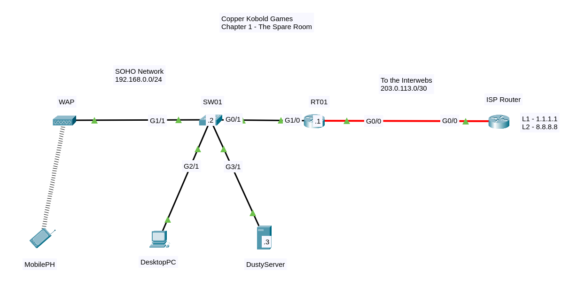

# Chapter 1 — The Spare Room

> **Company:** Copper Kobold Games
>
> **Status:** Accepted — 2026-11-21. Baseline `chapter-1-v1`.
>
> **Starting point:** New Packet Tracer network

[Project overview](../../README.md) · [Troubleshooting record](troubleshooting.md)

## Field Briefing

Joe Park has a day job, a spare room and an idea that won’t leave him alone: *Banners of Ashvale*, a mobile fantasy strategy RPG about small kingdoms, grumpy orc warlords and a kobold mascot who keeps stealing your gold. Joe names the company after the kobold. It feels like a joke at the time.

The spare room has a workstation, a small development server humming in the closet, and Joe’s old phone with the cracked screen—now officially “the test device.” Joe needs a dependable network for development, access to the game’s test website and connectivity beyond the home office. Client devices should receive their network settings automatically, and the test site should be reachable by name.

There’s no staff yet and no need for an elaborate network. However, Joe has the familiar sticky note on his monitor: *build it like you’ll need more someday.*

Your assignment is to design and build Copper Kobold’s first network.

## Objectives

For this assignment to be successful, you must:

- Design an IPv4 addressing plan that supports the current office and leaves room for growth.
- Connect the workstation, development server and wireless access point.
- Apply consistent device naming and baseline device-access protection.
- Provide DHCP addressing and local DNS name resolution.
- Make the server’s HTTP test page accessible by name from the workstation and any included wireless client.
- Provide routed access to simulated external destinations using NAT.
- Demonstrate the required behaviour and save a reviewable Packet Tracer file.

## Equipment and Starting Conditions

Start with a blank Packet Tracer workspace.

| Device | Quantity | Role |
|---|---:|---|
| Edge router | 1 | Connect the home-office LAN to the simulated ISP and perform NAT. |
| Layer 2 switch | 1 | Connect the wired office devices; the submitted Switch-PT-Empty is accepted for this chapter’s basic switching requirements. |
| PC | 1 | Joe’s development workstation. |
| Server | 1 | Represent the development server, host the HTTP test page and provide local DNS. It may also host DHCP. |
| Wireless access point | 1 | Provide wireless access to the office LAN. |
| Smartphone | Optional | Represent Joe’s test phone and verify wireless connectivity. |
| ISP router | 1 | Provide the upstream connection and loopback interfaces representing external destinations. |

Choose router models with enough Ethernet interfaces for these roles.

The server represents the business’s development resources. Use Packet Tracer’s built-in services for the HTTP test site and local DNS. DHCP may run on the edge router or this server; choose one. You do not need to install a game, build system or file-sharing platform.

The ISP router and its loopbacks represent the internet. This lab does not connect to the real internet.

## Access and Required Parameters

| Item | Requirement |
|---|---|
| Office addressing | Use private IPv4 addresses. Keep infrastructure and the server static; use DHCP for the workstation and optional smartphone. |
| DHCP | Use one DHCP service on the office LAN. Supply the correct subnet mask, default gateway and local DNS server address; keep static addresses outside the lease pool. |
| DNS | Use the server’s built-in DNS service. Create an A record for `dev.kobold.test` pointing to the server’s fixed IPv4 address. |
| Address planning | Use VLSM where appropriate; leave unallocated space for future sites and segmentation. |
| ISP link addressing | Choose the edge-to-ISP subnet from `192.0.2.0/24`, `198.51.100.0/24` or `203.0.113.0/24`. |
| External destinations | Use ISP loopbacks `1.1.1.1/32` and `8.8.8.8/32` as agreed simulated reachability targets. They do not provide the corresponding real-world DNS services. |
| Office layout | One shared LAN for this chapter. |
| Routing | Use static/default routing as needed. |
| Translation | Allow office hosts to share the edge router’s ISP-facing address using NAT overload. |
| Test service | Enable HTTP on the development server; verify access by IP address and at `http://dev.kobold.test/koboldgaming.html`. |
| Credentials | Choose lab-only passwords and a wireless passphrase. |

DHCP stays on the single office LAN; no relay is needed in this chapter. DNS provides the local test-site record, not real internet name resolution. Departmental VLANs and remote-office connections are deferred to later assignments.

## Design Decisions

You choose:

- The private address block, subnet sizes and individual addresses.
- Whether DHCP runs on the edge router or server, and how the lease pool leaves room for static infrastructure addresses.
- How much address space to reserve for future growth.
- Device names, interface selections and descriptions.
- The wireless network name and passphrase.
- Lab credentials and a consistent naming scheme.

Be ready to explain why the addressing plan fits the current network and how it leaves room for expansion. The tutor will capture your reasoning and maintain the documentation.

## Section 1A — Establish the Home Office

### Task 1 — Plan the Network

**Objective:** Produce a coherent topology and addressing plan before configuring devices.

1. Identify the connections needed between the workstation, server, access point, switch, edge router and ISP router.
2. Select a private address block and allocate the office subnet. Set aside fixed addresses for infrastructure and the server, then define a non-overlapping DHCP lease range for clients. Identify the gateway and DNS settings DHCP must supply.
3. Leave room for separate, non-overlapping networks as the company grows. For this accepted chapter, exact remote-office and later segmentation allocations are deferred to the relevant expansion; do not build those networks now.
4. Allocate a separate subnet for the edge-to-ISP link from the documentation ranges. Use `1.1.1.1/32` and `8.8.8.8/32` for the two agreed simulated ISP destinations.
5. Identify each host’s default gateway and explain the intended path from the workstation to an external destination.

**Checkpoint:** Every planned interface or host has a valid fixed address or DHCP allocation where needed, subnets and address allocations do not overlap, and the growth allowance is identifiable.

### Task 2 — Assemble and Configure the Office

**Objective:** Establish a working wired LAN with consistent device configuration.

1. Place and cable the required equipment using suitable interfaces and cable types.
2. Assign meaningful hostnames to the IOS devices and descriptions to used interfaces.
3. Configure baseline device access: an enable secret, console and VTY authentication, password encryption, a login banner and idle timeouts. A 30-minute timeout is permitted for lab convenience; unchanged line defaults are also acceptable for this chapter.
4. Configure the office-facing router interface and the server’s fixed address, mask and gateway. The workstation will obtain its settings through DHCP in Task 3.
5. Configure a switch-management address and default gateway so the switch can be checked from the workstation.
6. Shut down unused switch ports, preserving ports allocated to the planned connections.
7. Save the IOS configurations.

**Checkpoint:** Required wired links are operational. The server can reach the office gateway and switch-management address using its fixed configuration.

### Task 3 — Provide DHCP and DNS

**Objective:** Give client devices automatic network settings and a usable name for the development server.

1. Enable one DHCP service on your chosen device and configure the planned lease range. Exclude all fixed infrastructure and server addresses from dynamic allocation.
2. Supply the office subnet mask, default gateway and local DNS server address through DHCP.
3. Set the workstation to obtain its network settings automatically. Verify the issued address is within the intended pool and the mask, gateway and DNS settings match the plan.
4. Inspect the DHCP lease or binding information available on your chosen device and relate it to the workstation’s address.
5. Enable DNS on the server and create the A record for `dev.kobold.test` using its fixed IPv4 address.
6. From the workstation, verify that the name resolves to the expected address. Confirm connectivity to the server, office gateway and switch-management address.

**Checkpoint:** The workstation has valid DHCP settings, the lease is evidenced, and the test-site name resolves to the server’s fixed address.

### Task 4 — Bring the Test Site and Wireless Access Online

**Objective:** Make the development service available to Joe’s devices.

1. Enable HTTP on the server. Use a simple page that identifies it as the Copper Kobold development site; a line of text is enough.
2. From the workstation, open `http://<server-IP>/koboldgaming.html` in the web browser, then open `http://dev.kobold.test/koboldgaming.html`. Confirm that both load the same page.
3. Configure the access point with your chosen SSID and WPA2-PSK security, using a compatible Packet Tracer model.
4. If including the smartphone, associate it with the wireless network and obtain its settings through DHCP. Verify its assigned address, mask, gateway and DNS server.
5. If included, use the smartphone to open `http://dev.kobold.test/koboldgaming.html` and verify access to the server’s HTTP page.
6. Save a Section 1A working copy.

**Checkpoint:** The workstation loads the correct page by IP address and name. If included, the smartphone associates successfully, receives valid DHCP settings and loads the page by name. Without a wireless client, wireless operation remains unverified.

**Stopping point:** Section 1A can be submitted for review before starting Section 1B.

## Section 1B — Connect Beyond the Spare Room

### Task 5 — Establish the Simulated ISP

**Objective:** Give the home office a working upstream path and identifiable external test destinations.

1. Configure and enable both ends of the edge-to-ISP link.
2. Create the two planned loopback interfaces on the ISP router.
3. Configure the edge router’s route for destinations outside its directly connected networks.
4. Verify reachability between the edge router and the ISP link address.
5. Verify that the edge router can reach both ISP loopbacks.

**Checkpoint:** The edge router has a valid upstream route and can reach both simulated external destinations.

### Task 6 — Provide Translated Access for Office Hosts

**Objective:** Allow private office hosts to reach the simulated external destinations through the edge router.

1. Configure NAT overload using the edge router’s ISP-facing address.
2. Limit the translation selection to the intended office address range.
3. Identify the correct inside and outside interfaces.
4. Generate traffic from the workstation and server to both ISP loopbacks.
5. Inspect the resulting translations and confirm that the private source addresses are translated as intended.
6. Repeat external reachability checks from the smartphone if it is included.

**Checkpoint:** Office hosts receive replies from both external destinations, and the edge router provides observable NAT evidence.

### Task 7 — Validate and Save the Completed Network

**Objective:** Demonstrate that external access works without disrupting the local network.

Run the following checks and retain the relevant results:

| Check | Test location | Expected result |
|---|---|---|
| Local host connectivity | Workstation and server | Both can reach each other and the office gateway. |
| DHCP | Workstation and optional smartphone; DHCP service | Clients receive valid, unique addresses and the planned mask, gateway and DNS settings. Lease evidence matches the clients; fixed addresses are excluded from allocation. |
| DNS | Workstation | `dev.kobold.test` resolves to the server’s fixed IPv4 address. |
| Switch management | Workstation | Switch-management address responds. |
| Development website | Workstation browser | Copper Kobold test page loads by IP address and at `http://dev.kobold.test/koboldgaming.html`. |
| Wireless service, if included | Smartphone | Associates successfully, receives DHCP settings and loads the test page by name. |
| External connectivity | Workstation, server and optional smartphone | Both ISP loopbacks respond. |
| Address translation | Edge router | Translations show the generated office traffic using the selected outside address. |
| Interface state | IOS devices | Required interfaces are operational; unused switch ports are administratively shut down. |
| Saved configuration | IOS devices and Packet Tracer file | Intended configurations are saved and the working file contains the completed build. |

Useful inspection commands include:

- `ipconfig /all` on the workstation — inspect the assigned address, mask, gateway and DNS server.
- `nslookup dev.kobold.test` on the workstation — verify the name resolves to the expected server address.
- `show ip dhcp binding` if using IOS DHCP, or the server’s DHCP lease view where available — inspect lease evidence. Packet Tracer Simulation-mode DHCP messages can provide evidence when a lease view is unavailable.
- `show ip interface brief` — check addressing and interface state.
- `show ip route` — inspect connected and configured routes.
- `show ip nat translations` — inspect translations while generating traffic.
- `show ip nat statistics` — inspect NAT activity and interface roles.
- `show interfaces status` — inspect switch-port state.
- `show startup-config` — confirm the saved configuration.

Save the final Packet Tracer file after completing these checks.

## Completion Check

- [x] The addressing plan is valid and includes an explained growth allowance.
- [x] Required equipment is connected and consistently named.
- [x] Baseline device-access configuration is present.
- [x] Clients receive correct DHCP settings, and fixed addresses are excluded from the lease pool.
- [x] Local DNS resolves `dev.kobold.test` to the server’s fixed address.
- [x] Wired connectivity and the development website work by IP address and name.
- [x] Wireless configuration is present; client testing is recorded as passed or not performed.
- [x] Required office hosts reach both ISP loopbacks.
- [x] NAT evidence supports the observed external connectivity.
- [x] Unused switch ports are shut down.
- [x] Configurations and the submitted Packet Tracer file are saved.
- [x] Tutor review has resolved outstanding findings.

## Submission and Review

Provide the saved working file’s path and the results of the required tests. A topology screenshot will also be needed for the accepted chapter record.

The tutor will inspect the saved network, compare it with this brief and review the behavioural evidence. Configuration inspection alone does not prove connectivity. Findings will come back as investigation pointers for you to work through.

The tutor maintains the records below; you do not need to write a separate report.

## Topology and Accepted Lab

- **Accepted Packet Tracer baseline:** [network.pkt](network.pkt) — preserve unchanged; use copies for further work and troubleshooting.
- **Working Packet Tracer file:** [spare-room.pkt](spare-room.pkt).
- **Baseline version:** `chapter-1-v1`.
- **Baseline SHA-256:** `059548ee5c6adecccd14b34f98054eb7c3615d6e1361158a6e1134d59e8c0b3f`.
- **Accepted:** 2026-11-21, based on saved-state inspection and Matt’s reported Packet Tracer tests.

## Design Response

Matt chose the standard private network `192.168.0.0/24` and intentionally kept this first home-office chapter on one shared LAN without departmental VLANs. He noted that a typical small home setup might combine routing, switching and wireless in one device; separate devices here expose those configurations for hands-on practice.

The next expansion will integrate additional networks as the company grows and Joe needs more developers. The accepted growth approach leaves future sites on separate, non-overlapping networks; exact subnet reservations have not been selected and are deferred to that expansion. No specific future allocations are attributed to Matt. The `/24` provides 254 usable addresses, with only a small portion currently used.

The table records the accepted implementation:

| Component | Saved configuration |
|---|---|
| RT01 office interface | 192.168.0.1/24 |
| SW01 management | 192.168.0.2/24; gateway 192.168.0.1 |
| Server0 | 192.168.0.3/24; gateway 192.168.0.1; DNS-client setting 192.168.0.3 |
| DHCP | RT01 pool KOBOLD-NET: 192.168.0.0/24; .1, .2 and .3 excluded; gateway .1 and DNS .3 |
| Client DNS fields | PC0 and phone both use 192.168.0.3 |
| DNS and HTTP | Server0 services enabled; dev.kobold.test → 192.168.0.3; koboldgaming.html present |
| Wireless | KoboldNetwork; active AP/phone authentication, encryption and nonempty key match; successful phone access by name reported |
| ISP link | RT01 203.0.113.1/30 ↔ ISP-RTR 203.0.113.2/30 |
| ISP loopbacks | 1.1.1.1/32 and 8.8.8.8/32; explicitly retained as isolated simulated destinations |
| Upstream routing/NAT | Default via 203.0.113.2; overload on Gi0/0, inside Gi1/0; ACL 1 matches 192.168.0.0/24 |

## Review and Acceptance

**Progress reported 2026-11-14:** Matt has drawn and labelled the topology and performed some baseline configuration on the switch and both routers. Task 2 is nearly complete; the working file is saved as `spare-room.pkt`.

**Focused inspection 2026-11-16:** Matt reports workstation address `169.254.39.206` and requests a nudge. The saved file has PC0 configured as a DHCP client and an RT01 DHCP pool whose network/mask matches its LAN interface. This is configuration evidence, not proof that a lease exchange succeeds. No network configuration was changed; the live failure cause and all behavioural acceptance checks remain unverified.

**Investigation pointer supplied:** “Use Simulation mode, filter for DHCP and ARP, then request DHCP again on the workstation. Follow the exchange: does its Discover reach RT01, and does an Offer come back? Tell me the last DHCP message you see and which device it reaches.”

This is assistance with the learner's build, not a sabotage exercise. Full chapter review remains pending.

**DHCP follow-up 2026-11-16:** Matt supplied router PING_CONFLICT messages for `192.0.2.2` and `192.0.2.3` and identified that only the router address had been excluded, leaving the statically addressed switch and server in the lease range. The tutor prompted comparison of static addresses with DHCP exclusions: “Does DHCP know about every address you’ve already given to a device, or only some of them?” After Matt proposed correcting the exclusions, the tutor advised: “Exclude the fixed addresses, then renew PC0’s lease and check that it gets an unused address.”

Matt reports PC0 continued receiving `.2` and the router terminal froze; after closing and reopening Packet Tracer, PC0 obtained a DHCP address and responded to a router ping. The latest lease address/settings and revised exclusions have not been inspected, and the cause of the freeze is not established. DHCP recovery is learner-reported, not full Task 3 acceptance. Matt also reports configuring NAT overload, which is part of Task 6; external reachability and translation verification remain pending.

**DNS and HTTP follow-up 2026-11-16:** Matt recognised that the simulated ISP loopback did not provide a DNS service. The tutor confirmed that the DHCP DNS option should point to the local DNS server, explained that an A record maps a name to an IPv4 address, and distinguished the HTTP filename from the DNS name. Matt reported successful PC0 name resolution to `192.0.2.3`, phone access to `http://192.0.2.3/koboldgaming.html`, and a phone ping to `1.1.1.1`. The phone still held DNS address `1.1.1.1`; after the tutor advised obtaining a fresh DHCP lease, Matt reported that renewal restored access by name at `dev.kobold.test`.

Matt now considers the build complete. These are learner-reported tests, not full chapter acceptance. Confirm the latest saved submission, then inspect it against the brief and identify remaining behavioural evidence. The reported hostname differs from the brief's `dev.copperkobold.test`; reconcile it during review rather than silently changing the requirement. NAT verification, all required source/destination checks, design reasoning and the topology capture remain to be assessed.

### Submission review — 2026-11-16

Matt confirmed all latest changes were saved to `spare-room.pkt`. Reviewed SHA-256: `859fba44adeced210a2b72af8a7e451758c652d7ec6a4fdc404d919186c2bc2a`. The file was inspected only; no configuration was changed.

| Requirement / area | Evidence and finding | Result |
|---|---|---|
| DHCP configuration | Fixed addresses .1–.3 excluded; pool gateway and local DNS match the saved LAN/server configuration | Saved-state check passes; final client lease evidence pending |
| DNS / HTTP service | Enabled, with an A record and custom HTML file; user reports successful phone access by name after renewal | Function reported; chosen name/path differ from the brief and need agreement |
| Saving IOS configuration | Running and startup configs identical on RT01, ISP-RTR and SW01 | Pass |
| Addressing constraints / growth | Compare saved LAN and loopback allocations with Task 1 and required address categories; future reservations and reasoning not yet supplied | Needs review |
| NAT selection | Compare the address range selected by ACL 1 with the office subnet required by Task 6 | Needs review; translation evidence pending |
| Wireless | Compare saved access-point and phone settings with Task 4’s SSID/security requirement | Needs review |
| Device baseline | Check used switch-port descriptions and authentication coverage across every VTY range against Task 2; confirm intended idle-timeout behaviour | Needs review |
| Connectivity and NAT behaviour | Existing reports cover selected pings and website/name access, not the full test matrix | Remaining evidence pending |
| Topology capture | No actual image submitted | Pending |

Lint returned no ERROR/WARN entries and one INFO about SW01 VTY transport. That result does not override the requirement checks above. Review pointers supplied cover address categories, NAT selection scope, wireless settings and baseline completeness; no corrective configuration commands were provided. No accepted baseline created.

### Resume review — 2026-11-21

At Matt's request for a clear issue/action breakdown, re-inspected the current saved working file (SHA-256 `a430110dcb631c0b84a5dc19ca31a00a38ec97bfab2d8703a4e2343b801b0935`). The previously flagged address categories, NAT selection scope, wireless settings and baseline completeness still need attention. Current DNS record and client DNS settings are present; behaviour has not been retested. No network configuration changed.

The resume checklist explains the required address-category changes and dependent settings, NAT scope alignment, wireless security, interface descriptions/all VTY ranges, and final test evidence. Idle-timeout behaviour requires confirmation rather than assuming an omitted command means no timeout. Also reconcile the existing generic switch model with the brief's 2960 specification and the chosen website name/path with the brief before acceptance; do not require a hardware rebuild solely for an unreviewed model difference. Matt requested direct explanations of the outstanding work; no CLI repair script was supplied.

**Guided wireless setup — 2026-11-21:** Matt requested direct help configuring the access point. Tutor supplied GUI steps for the AP wireless interface (SSID, WPA2-PSK, passphrase and AES), matching phone settings, and DHCP/gateway/website checks. Setup and verification remain learner work and are not yet reported complete; record this as guided assistance. No lab configuration was edited by the tutor.

### Wireless and renumbering follow-up — 2026-11-21

Matt confirmed the lab was saved after configuring the WAP and reported phone website access by name plus successful pings from each device to other endpoints. Reviewed SHA-256: `27a713abfdbce3fd10c4fe5b7264ce4a184da36147b9063800eb7d07b188dd84`. File inspection was read-only.

**Confirmed improvements:** LAN is now private 192.168.0.0/24; router DHCP network/exclusions/options and server DNS record follow the new addresses; NAT selection matches the LAN; used switch ports have descriptions; RT01 VTY 5–15 now has a password. AP and phone active SSID/authentication/encryption/key match (KoboldNetwork, saved auth/encryption enums 4/4); phone association and service access are learner-reported. All three IOS running/startup configurations match. Unused switch ports remain shut down.

**Remaining checks:** SW01's saved default gateway references the old subnet; PC0's saved DNS field references the old server address (confirm current lease and browser/name behaviour); Server0's own DNS-client field still points at the simulated ISP loopback. SW01 VTY 5–15 still lacks a password/local-user authentication. Loopbacks remain outside the assigned documentation ranges. Confirm effective idle timeouts. Hostname/path and generic switch-model variations still need explicit agreement against the brief.

**Evidence remaining:** Matt's successful pings are recorded as reported results; exact source/destination coverage and NAT translations were not observed. Obtain translation output while client traffic runs, confirm both loopbacks were tested from required hosts and switch management return-path connectivity, capture the topology and record growth reservations/reasoning. Do not infer a successful NAT table or complete acceptance from a general ping report. No accepted baseline created.

**Learner update — 2026-11-21:** Matt reports completing the SW01 gateway, PC0 DNS, Server0 DNS-client and SW01 VTY authentication items. These changes have not yet been re-inspected. He asks for clarification of ISP loopbacks and says idle timeouts have not been covered in his course. Tutor clarified that the loopback addresses are functional simulated destinations; the issue is compliance with the brief's addressing convention, not broken routing. Tutor explained idle CLI session timeouts and Cisco's documented ten-minute default. Proposed retaining the isolated simulation loopbacks as a documented exception and using default idle timeouts rather than adding new configuration work; no requirement exception has yet been agreed or applied.

### Configuration closeout review — 2026-11-21

Matt confirmed the latest changes were saved and explicitly approved retaining the ISP loopbacks. Inspected SHA-256: `1aea7817ec0f36a7961860263a167ed140e881fab6318bab335503790e36a6a0`. The source file was not modified.

**Configuration review passes:** SW01 now uses gateway 192.168.0.1; PC0, the phone and Server0 use local DNS 192.168.0.3; SW01 VTY 5–15 now has a password and login configured. DHCP exclusions/options, the server A record, matching AP/phone wireless settings, subnet-aligned NAT selection, upstream default route, used-port descriptions and unused-port shutdowns remain present. Running/startup configurations match on all three IOS devices. Lint reports no ERROR/WARN entries; Telnet transport on later VTY ranges remains a lab limitation, not a new SSH-only requirement.

**Timeout choice:** Matt deliberately chose 30 minutes to reduce interruptions while working in the lab and would normally use a shorter interval elsewhere. Saved `exec-timeout 30 0` appears on RT01 console and VTY 5–15, plus SW01 console and VTY 0–15. RT01 VTY 0–4 and ISP-RTR lines retain defaults; the 30-minute choice is not applied universally, and no universal override is required.

**Brief reconciled:** Keep 1.1.1.1/32 and 8.8.8.8/32 as explicitly approved isolated ISP destinations; documentation-range requirements still apply to the WAN link. Accept the existing dev.kobold.test/koboldgaming.html naming and generic Layer 2 switch as functionally equivalent design choices for this chapter. Active assignment text now matches those choices; historical review entries are retained.

**Next:** Matt can take the topology screenshot now. Final acceptance still needs the actual image, NAT translation evidence, identification of the reported ping-test coverage and the addressing-growth reservations/reasoning. No repeated tests are required where Matt can identify already successful checks; configuration inspection does not fabricate their outputs. No accepted baseline created yet.

### Chapter 1 accepted — 2026-11-21

**Final submission:** `059548ee5c6adecccd14b34f98054eb7c3615d6e1361158a6e1134d59e8c0b3f`. The saved file changed after the preceding check; a fresh summary/lint and comparison confirmed the reviewed IOS running/startup, DNS, HTTP and wireless configuration blocks were unchanged. Latest client/server addressing remains consistent. The accepted `network.pkt` is a byte-for-byte copy of this submission.

**Learner-run test confirmation:** Matt explicitly confirmed NAT translation from all endpoints to the ISP loopback addresses and successful endpoint ping testing. This closes the previously requested PC0/server/phone coverage of both simulated ISP destinations. Earlier live reports established DHCP assignment and website access by IP and name, including the phone after renewal. The tutor accepts these as Matt’s reported execution evidence; no CLI output capture was supplied and the tutor did not independently execute Packet Tracer tests.

**Topology and reasoning:** Matt supplied the real topology screenshot now embedded above and explained the shared `/24`, absence of departmental VLANs, separate devices for configuration practice and planned integration of future networks. Exact future subnet allocations are deferred as a recorded design decision, rather than invented. The original requirement to preselect reservations is reconciled in Task 1 accordingly.

| Acceptance area | Evidence | Outcome |
|---|---|---|
| Addressing and growth | Private LAN, separate documentation-range WAN, agreed simulated loopbacks; learner’s design explanation and deferred future allocations | Accepted |
| Device baseline and saved state | Inspected access configuration, used-port descriptions, unused-port shutdowns, lab timeouts, matching IOS running/startup configs | Accepted |
| DHCP, DNS and HTTP | Inspected settings plus Matt’s successful client/service tests | Accepted |
| Wireless | Matching saved AP/phone SSID/security/key and Matt’s successful association/website test | Accepted with guided setup recorded |
| Local/external reachability and NAT | Inspected routing/NAT configuration plus Matt’s explicit all-endpoint ping/translation confirmation | Accepted on learner-reported tests |
| Topology and baseline preservation | Actual screenshot; unchanged source copied to versioned network.pkt with SHA-256 | Accepted |

Matt designed, configured, diagnosed and repaired the network. The tutor supplied the assignment, investigation pointers, requested explanations and guided wireless setup, reviewed saved state and maintained records. This was an assisted learning build, not a claim of an unaided assessment. No sabotage exercise has been run. The next action is optional troubleshooting on a separate copy, or agreeing Chapter 2 when Matt is ready.

## Troubleshooting

[No exercises have been run.](troubleshooting.md) Chapter 1 is accepted; an optional addressing or default-gateway exercise can be prepared on a separate copy when Matt requests one.
